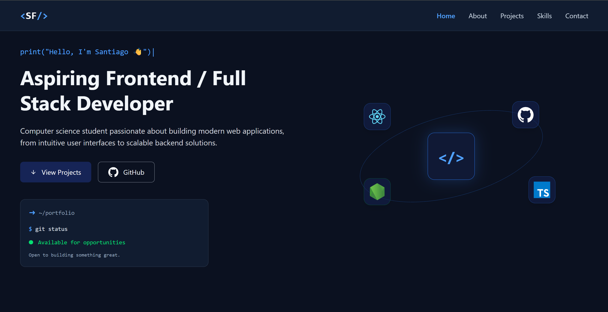

# Santiago Fernandes — Developer Portfolio

My personal developer portfolio, built with **React, TypeScript, Vite and Tailwind CSS**.

This website showcases my software development projects, technical skills, academic background and professional interests.

Designed with a minimalist dark-blue interface, the portfolio focuses on simplicity, responsiveness and a consistent user experience.

## Portfolio Preview



**Live Website:** [santiagofernandes.dev](https://santiagofernandes.dev)

---

## Tech Stack

| Technology | Purpose |
|---|---|
| React | Component-based user interface |
| TypeScript | Type-safe application development |
| Vite | Development server and production builds |
| Tailwind CSS | Responsive styling and UI design |
| Git & GitHub | Version control and source code management |
| Cloudflare Pages | Hosting and automated deployment |

## Features

### Responsive Design

- Responsive layout for desktop and mobile devices.
- Mobile navigation with an animated hamburger menu.
- Consistent spacing, typography and component styling.
- Minimalist dark-blue visual identity.

### Hero Section

- Personal introduction and developer profile.
- Interactive technology-themed visual elements.
- Navigation to featured projects.
- Direct access to GitHub.
- Terminal-inspired availability status.

### About Me

- Personal and academic background.
- Introduction to my development journey.
- Professional interests and career ambitions.

### Projects

- Dedicated project showcase.
- Reusable React components.
- Project screenshots and descriptions.
- Technologies used in each project.
- Links to GitHub repositories.
- Development status indicators for ongoing projects.

### Skills

- Overview of programming languages, frameworks and tools.
- Technology logos for visual identification.
- Responsive organization of technical skills.

### Contact

- Contact information and professional profiles.
- Email, GitHub and LinkedIn links.
- Dedicated icons and interactive elements.

### SEO and Branding

- Custom favicon.
- HTML metadata for search engines.
- Page title and description.
- Consistent personal branding.

## Featured Projects

The portfolio highlights projects developed during my academic journey and independent learning.

### Task Manager API

A task management application developed using Node.js and Express, with CRUD operations and task organization features.

### Aromatic Herbs Cultivation Management

A web application for managing aromatic herb cultivation, including users, cultivation plans, batches, tasks, environmental measurements and alerts.

### FinTrack

A personal finance management project focused on expense tracking, financial organization and full-stack development.

### Numerical System

An academic project exploring numerical systems and programming concepts.

Additional details and source code are available through the project cards on the website.

## Project Structure

The application follows a component-based React architecture.

```text
santiago-portfolio/
├── public/
│   ├── favicon.svg
│   └── screenshots/
│       └── portfolio-preview.png
├── src/
│   ├── assets/
│   ├── components/
│   ├── data/
│   ├── App.tsx
│   ├── App.css
│   └── main.tsx
├── index.html
├── package.json
├── package-lock.json
├── vite.config.ts
└── README.md
```

The `components` directory contains reusable interface components, while `data` stores structured information used throughout the portfolio.

## Getting Started

Follow these instructions to run the project locally.

### Prerequisites

Make sure you have installed:

- Node.js
- npm
- Git

### 1. Clone the repository

```bash
git clone https://github.com/santiiago90/santiago-portfolio.git
```

### 2. Navigate to the project directory

```bash
cd santiago-portfolio
```

### 3. Install dependencies

```bash
npm install
```

### 4. Start the development server

```bash
npm run dev
```

Open the local URL displayed in the terminal, usually:

`http://localhost:5173`

### 5. Create a production build

```bash
npm run build
```

The optimized application will be generated in the `dist/` directory.

## Development Process

The portfolio was developed iteratively across five sprints.

| Sprint | Main objectives |
|---|---|
| Sprint 1 | Project initialization, development environment and initial React components |
| Sprint 2 | Dark-blue visual theme, project data, skills and interface consistency |
| Sprint 3 | Mobile navigation, responsive improvements and component interactions |
| Sprint 4 | Project cards, interactive elements and UI refinements |
| Sprint 5 | Portfolio redesign, personal content improvements, CV integration and final polishing |

This iterative approach helped improve code organization, component reusability and user experience throughout development.

## Deployment

The website is hosted on **Cloudflare Pages**, connected directly to this GitHub repository.

### Production Configuration

| Setting | Value |
|---|---|
| Hosting provider | Cloudflare Pages |
| Production branch | `main` |
| Framework preset | React (Vite) |
| Build command | `npm run build` |
| Build output directory | `dist` |
| Custom domain | `santiagofernandes.dev` |
| HTTPS / SSL | Enabled |

Updates pushed to the production branch trigger automatic builds and deployments through Cloudflare Pages.

The website uses HTTPS with SSL/TLS managed by Cloudflare.

## Version Control

Git and GitHub were used throughout development.

The project followed a branch-based workflow:

- `main` — Production-ready code.
- `dev` — Development and testing.
- Pull requests — Review and integration of changes.
- Squash and merge — Consolidation of development commits into the production branch.

## Future Improvements

The portfolio will continue evolving alongside my technical experience.

Potential improvements include:

- Adding new projects and case studies.
- Improving accessibility and performance.
- Expanding project documentation.
- Updating technical skills and professional experience.
- Further SEO optimization.

## About Me

I'm Santiago Fernandes, a Computer Science student at the **University of Beira Interior (UBI)**, Portugal, pursuing a degree in Web, Mobile and Cloud Computing.

I'm interested in frontend and full-stack development, particularly in building modern, responsive and user-friendly web applications.

My goal is to continue developing my technical skills through practical projects and professional experience.

## Contact

- **Website:** [santiagofernandes.dev](https://santiagofernandes.dev)
- **GitHub:** [github.com/santiiago90](https://github.com/santiiago90)
- **LinkedIn:** Available through my portfolio.
- **Email:** Available through my portfolio.

---

## Copyright

**© 2026 Santiago Fernandes. All rights reserved.**

This portfolio was designed and developed by Santiago Fernandes.

Unauthorized copying, redistribution, modification or commercial use of the original source code and design is prohibited without prior written permission from the copyright holder.

Third-party libraries, frameworks, assets and other dependencies remain subject to their respective licenses and copyright terms.

---

**Designed and developed by Santiago Fernandes.**
